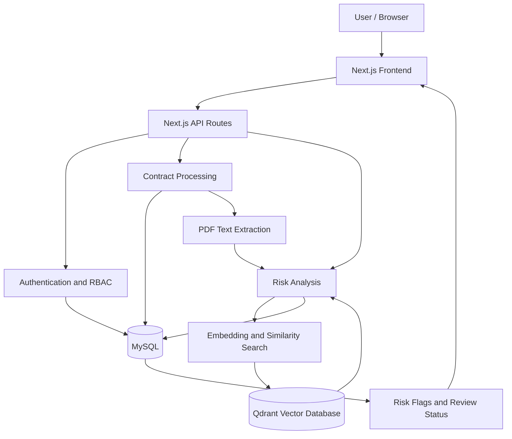

# ⚖️ Contract Risk & Clause Intelligence Platform

An AI-assisted contract analysis and risk management system built with **Next.js, MySQL, and Qdrant**. The platform combines relational database management, document processing, semantic similarity search, and role-based access control to help users identify potentially risky clauses and manage contract reviews.

<p align="center">
  <strong>Contract Management · Semantic Risk Analysis · RAG · Role-Based Access Control</strong>
</p>

---

## 📌 Table of Contents

- [Overview](#-overview)
- [Problem Statement](#-problem-statement)
- [Objectives](#-objectives)
- [Key Features](#-key-features)
- [Technology Stack](#-technology-stack)
- [System Architecture](#-system-architecture)
- [Database Design](#-database-design)
- [User Roles](#-user-roles)
- [Project Structure](#-project-structure)
- [Getting Started](#-getting-started)
- [Environment Configuration](#-environment-configuration)
- [Running the Application](#-running-the-application)
- [API Overview](#-api-overview)
- [Testing](#-testing)
- [Troubleshooting](#-troubleshooting)
- [Limitations and Disclaimer](#-limitations-and-disclaimer)
- [Future Enhancements](#-future-enhancements)
- [Contributors](#-contributors)
- [License](#-license)

---

## 🧠 Overview

Contract Risk & Clause Intelligence Platform is a web-based application designed to streamline contract review by combining structured contract management with AI-assisted risk identification.

Traditional contract review often requires manually reading lengthy documents, locating potentially unfavorable clauses, comparing contractual language, and tracking obligations and deadlines. This process can be time-consuming and difficult to manage across multiple agreements.

The platform addresses these challenges through a unified application that supports contract uploads, clause analysis, risk flag generation, review workflows, and obligation management.

It combines two complementary data approaches:

- **Relational data management:** MySQL stores users, contracts, clauses, risk categories, review flags, obligations, deadlines, and their relationships.
- **Semantic search:** Qdrant stores vector representations used to retrieve semantically similar risk patterns and supporting information.

The result is a practical demonstration of how database management, document processing, and AI-assisted information retrieval can work together in a contract management workflow.

## 🎯 Problem Statement

Manual contract review presents several challenges:

- Important risk clauses can be overlooked in lengthy agreements.
- Similar clauses may be expressed using different wording.
- Contract information and review status can be difficult to track consistently.
- Obligations and deadlines require ongoing monitoring.
- Multiple users need different levels of access to contract operations.

**The objective is to build a centralized system that supports contract analysis, risk identification, structured data management, and controlled review workflows.**

## 🎯 Objectives

1. Develop a centralized interface for contract management.
2. Extract and process text from uploaded contract documents.
3. Identify potentially risky clauses using semantic similarity and stored risk patterns.
4. Maintain structured contract and risk information in a relational database.
5. Integrate vector search for semantic retrieval.
6. Implement role-based authentication and authorization.
7. Support risk review, obligation management, and deadline tracking.
8. Demonstrate the integration of a modern web application with relational and vector databases.

## ✨ Key Features

### 📄 1. Contract Management

- Upload and manage contract documents.
- Maintain contract metadata and upload information.
- View existing contracts and their analysis status.
- Access contract-specific risk information.
- Avoid unnecessary repeat analysis when a contract has already been analyzed.

### 🔍 2. AI-Assisted Risk Analysis

- Extract text from supported contract documents.
- Process contract text for analysis.
- Compare contract content against stored risk patterns using semantic similarity.
- Retrieve relevant information through vector search.
- Generate risk flags associated with potentially problematic clauses.
- Present identified risks for further review.

### 🧠 3. Semantic Search and RAG

The vector database supports retrieval based on meaning rather than relying exclusively on exact keyword matches.

For example, a stored risk pattern concerning unilateral termination may be relevant to a contract clause that expresses the same concept using different wording.

The retrieval workflow uses embeddings and vector similarity to identify relevant patterns that can support risk analysis.

### 🚩 4. Risk Review Workflow

- View identified risk flags.
- Review risks associated with contracts.
- Mark eligible risk flags as reviewed.
- Track review status.
- Restrict review actions according to the authenticated user's role.

### 👥 5. Authentication and Authorization

- User registration and login.
- Password hashing using `bcryptjs`.
- Session-related authentication configuration.
- Role-based access control for Admin, Reviewer, and Viewer users.
- Server-side authorization checks for protected operations.

### 📊 6. Dashboard

- View contract information and analysis status.
- Monitor pending analysis.
- Access important contract-management sections.
- Navigate to risk review and related workflows.

### 📋 7. Obligations and Deadlines

- Maintain structured obligation information.
- Associate obligations with relevant contracts.
- Manage contractual deadlines.
- Support tracking of important contractual responsibilities.

---

## 🛠️ Technology Stack

| Technology | Purpose |
|---|---|
| Next.js 16 | Full-stack web application and API routes |
| React 19 | Interactive user interface |
| JavaScript | Application logic |
| Tailwind CSS 4 | UI styling |
| MySQL 8.4 | Relational database |
| Qdrant | Vector database and semantic search |
| Hugging Face Transformers | Embedding and model-related processing |
| `@qdrant/js-client-rest` | Qdrant integration |
| `mysql2` | MySQL connectivity |
| `pdf-parse` | PDF text extraction |
| `bcryptjs` | Password hashing |
| Docker Compose | Local database services |
| ESLint | Code linting |

---

## 🏗️ System Architecture

The application follows a layered architecture in which the frontend communicates with server-side API routes, which coordinate database operations, document processing, authentication, and semantic retrieval.



### Architecture Components

**1. Presentation layer**

The Next.js frontend provides the contract management, dashboard, login, signup, risk review, obligations, and deadlines interfaces.

**2. Application layer**

Next.js API routes handle requests for authentication, contract operations, risk analysis, and review workflows.

**3. Relational data layer**

MySQL maintains structured application data, relationships, and persistent workflow state.

**4. Semantic retrieval layer**

Qdrant supports vector similarity searches over stored risk patterns and related information.

**5. Document-processing layer**

Uploaded PDF content is extracted and prepared for downstream analysis.

---

## 🗄️ Database Design

The project uses MySQL for structured storage and Qdrant for vector retrieval.

### MySQL Schema

The relational schema contains 11 core tables.

| Table | Purpose |
|---|---|
| `roles` | Defines application roles |
| `users` | Stores user account information |
| `contracts` | Stores contract metadata |
| `parties` | Stores contract party information |
| `contract_parties` | Maps parties to contracts |
| `risk_categories` | Defines risk categories |
| `clauses` | Stores clause-related information |
| `risk_patterns` | Stores patterns used for risk identification |
| `risk_flags` | Records identified contract risks and review state |
| `obligations` | Stores contractual obligations |
| `deadlines` | Stores deadline-related information |

The schema includes supporting constraints, indexes, and additional database objects defined in the SQL scripts.

### Database Initialization Files

```text
database/
├── schema/
│   ├── 01_create_tables.sql
│   ├── 02_constraints_indexes.sql
│   └── 03_views_triggers_procs.sql
└── seed/
    └── sample_data.sql
```

### Qdrant

Qdrant provides vector storage and similarity-search functionality for semantic retrieval. The configured collection name is `risk_clauses`.

---

## 👥 User Roles

The application supports three user roles.

| Capability | Admin | Reviewer | Viewer |
|---|:---:|:---:|:---:|
| View dashboard, contracts, analysis, risks, obligations, and deadlines | ✓ | ✓ | ✓ |
| Upload or create contracts | ✓ | — | — |
| Run or rerun contract analysis | ✓ | — | — |
| View risk details and review status | ✓ | ✓ | ✓ |
| Mark risk flags as reviewed | ✓ | ✓ | — |
| Create obligations or deadlines where supported | ✓ | — | — |
| Manage users and roles | ✓ | — | — |

Authorization is enforced by the application rather than relying solely on whether a button is visible in the interface.

Public signup creates Viewer accounts. Elevated roles should be assigned through the appropriate administrative or database setup process.

---

## 📁 Project Structure

```text
Contract-Risk-Clause-Intelligence/
│
├── app/
│   ├── api/
│   │   ├── auth/
│   │   ├── contracts/
│   │   ├── deadlines/
│   │   ├── obligations/
│   │   ├── risk-flags/
│   │   └── users/
│   ├── contracts/
│   ├── dashboard/
│   ├── login/
│   ├── obligations/
│   ├── risk-review/
│   ├── signup/
│   ├── lib/
│   ├── layout.js
│   ├── page.js
│   └── globals.css
│
├── database/
│   ├── schema/
│   └── seed/
│
├── vector-db/
│   ├── analyze_risk.js
│   ├── embed_patterns.js
│   ├── search.js
│   ├── qdrant.js
│   └── docker-compose.yml
│
├── docs/
│
├── uploads/
│
├── .env.example
├── docker-compose.yml
├── package.json
├── package-lock.json
├── next.config.mjs
├── eslint.config.mjs
├── LICENSE
└── README.md
```

*The tree highlights the main areas of the project; individual files may change as development continues.*

---

## 🚀 Getting Started

Follow these instructions to run the project locally.

### Prerequisites

Install the following:

- [Node.js](https://nodejs.org/) — a version compatible with Next.js 16 (Node.js 20.9 or newer).
- [Git](https://git-scm.com/).
- [Docker Desktop](https://www.docker.com/products/docker-desktop/) with Docker Compose.
- A MySQL client such as [MySQL Workbench](https://dev.mysql.com/downloads/workbench/) for importing and inspecting the schema.

### 1. Clone the Repository

```bash
git clone https://github.com/Chinmay-Ns5/Contract-Risk-Clause-Intelligence.git
cd Contract-Risk-Clause-Intelligence
```

### 2. Configure Environment Variables

Create the application environment file.

**Windows PowerShell:**

```powershell
Copy-Item .env.example .env.local
```

Open `.env.local` and update the values for your local environment. See [Environment Configuration](#-environment-configuration).

The root Docker Compose file also requires a `.env` file for its database-service settings. Create it in the repository root with the values described in the next section.

Do not commit `.env` or `.env.local`.

### 3. Configure Docker Services

Create a root-level `.env` file:

```dotenv
MYSQL_ROOT_PASSWORD=choose_a_local_root_password
MYSQL_DATABASE=contract_risk_db
MYSQL_PORT=3306
QDRANT_PORT=6333
```

Use a strong local password and keep this file private.

Start MySQL and Qdrant:

```bash
docker compose up -d
```

Check that the containers are running:

```bash
docker compose ps
```

The default service ports are:

- MySQL: `localhost:3306`
- Qdrant HTTP API: `localhost:6333`
- Qdrant gRPC: `localhost:6334`

If you already have MySQL running locally, make sure its credentials and database name match `.env.local`. Avoid starting a second MySQL service on an occupied port.

### 4. Initialize the MySQL Database

Using MySQL Workbench or your preferred MySQL client, connect to your local MySQL server.

Run the SQL files in this order:

1. `database/schema/01_create_tables.sql`
2. `database/schema/02_constraints_indexes.sql`
3. `database/schema/03_views_triggers_procs.sql`
4. `database/seed/sample_data.sql`

The first three files establish the database structure and supporting objects. The seed file inserts the sample data used for local demonstration.

Verify that the `contract_risk_db` database and its tables have been created.

### 5. Install Dependencies

```bash
npm ci
```

This installs the dependencies recorded in `package-lock.json`.

### 6. Start the Development Server

```bash
npm run dev
```

Open:

**http://localhost:3000**

The application should now be available in your browser.

---

## ⚙️ Environment Configuration

The application uses `.env.local` for runtime configuration.

Example:

```dotenv
# MySQL connection
MYSQL_HOST=localhost
MYSQL_PORT=3306
MYSQL_USER=root
MYSQL_PASSWORD=your_local_root_password
MYSQL_DATABASE=contract_risk_db

# Session signing secret
AUTH_SECRET=replace_with_a_unique_random_secret_at_least_32_characters

# Qdrant vector database
QDRANT_URL=http://localhost:6333
QDRANT_COLLECTION=risk_clauses
```

### Generate an Authentication Secret

Run the following command:

```bash
node -e "console.log(require('node:crypto').randomBytes(32).toString('hex'))"
```

Copy the generated value into `AUTH_SECRET`.

### Configuration Notes

- `MYSQL_HOST` identifies the MySQL server.
- `MYSQL_PORT` identifies its port.
- `MYSQL_USER` and `MYSQL_PASSWORD` provide the application's database credentials.
- `MYSQL_DATABASE` specifies the application database.
- `AUTH_SECRET` is used for session-signing configuration.
- `QDRANT_URL` specifies the Qdrant endpoint.
- `QDRANT_COLLECTION` specifies the vector collection used by the application.

For the Docker setup above, make sure `MYSQL_PASSWORD` matches the root password configured in the Docker environment when using `MYSQL_USER=root`.

**Security:** Never commit real passwords, authentication secrets, API keys, or other credentials to GitHub. Do not use demonstration credentials outside the local demo environment.

---

## 🔑 Demo Login Accounts

The sample database seed includes the following demonstration accounts:

| Role | Email | Password |
|---|---|---|
| Admin | `alice@test.com` | `AdminDemo2026!` |
| Reviewer | `bob@test.com` | `ReviewerDemo2026!` |
| Viewer | `casey@test.com` | `ViewerDemo2026!` |

These credentials work only when the corresponding sample accounts have been loaded into your local database and the authentication configuration is correct.

Public signup creates Viewer accounts only.

These are development/demo credentials, not production accounts. Change or remove them before any public deployment.

---

## 🔌 API Overview

The application exposes API routes through the Next.js App Router.

| Endpoint | Method | Purpose |
|---|---|---|
| `/api/auth/signup` | POST | Register a user |
| `/api/auth/login` | POST | Authenticate a user |
| `/api/auth/logout` | POST | Log out a user |
| `/api/auth/session` | GET | Retrieve session information |
| `/api/contracts` | GET, POST | List and create contracts |
| `/api/contracts/[id]` | GET | Read an individual contract and its clauses |
| `/api/contracts/[id]/analysis` | POST | Run contract risk analysis (Admin only) |
| `/api/risk-flags` | GET | Retrieve risk flags |
| `/api/risk-flags/[id]` | PATCH | Mark a risk flag as reviewed (Admin or Reviewer) |
| `/api/obligations` | GET, POST | Retrieve and create obligations |
| `/api/deadlines` | GET, POST | Retrieve and create deadlines |
| `/api/users` | GET | Retrieve user information, subject to authorization |

The precise methods accepted by individual routes depend on their implementation. The table summarizes the primary operations.

Protected endpoints enforce the application's authorization rules. Unauthorized or insufficiently privileged requests should be rejected.

---

## 🧪 Testing

### Development Mode

```bash
npm run dev
```

### Production Build

```bash
npm run build
```

### Run the Production Server

After building:

```bash
npm run start
```

The production server uses the generated Next.js build.

### Linting

```bash
npm run lint
```

### Functional Verification Checklist

Before submitting or demonstrating the project, verify:

- [ ] Admin, Reviewer, and Viewer login flows.
- [ ] User registration and password handling.
- [ ] Contract creation and document upload.
- [ ] Contract analysis and risk-flag generation.
- [ ] Correct status for previously analyzed contracts.
- [ ] Risk review and reviewed-status persistence.
- [ ] Role restrictions for contract creation and risk review.
- [ ] Dashboard, obligations, and deadline navigation.
- [ ] MySQL connectivity and persistence.
- [ ] Qdrant connectivity and semantic retrieval.
- [ ] Production build completes successfully.

A successful build verifies compilation; the functional checklist verifies application behavior.

---

## 🛠️ Troubleshooting

### MySQL Connection Error

1. Confirm that the MySQL service is running.
2. Verify `MYSQL_HOST`, `MYSQL_PORT`, `MYSQL_USER`, `MYSQL_PASSWORD`, and `MYSQL_DATABASE`.
3. Confirm that the SQL schema and seed data have been imported.
4. Check that the configured database user has the necessary privileges.

### Qdrant Connection Error

1. Confirm that the Qdrant container is running.
2. Verify that `QDRANT_URL` points to the correct endpoint.
3. Confirm that the configured collection exists or is initialized by the application.
4. Check the Qdrant container logs for additional information.

### Login Fails

1. Verify that the sample data was imported.
2. Check the email and password.
3. Confirm that `AUTH_SECRET` is configured.
4. Inspect the browser console and application terminal for errors.

### Port Already in Use

If port `3000`, `3306`, or `6333` is already occupied, stop the conflicting service or adjust the relevant port configuration consistently.

### Dependency Installation or Build Issues

Use the project's committed lockfile:

```bash
npm ci
npm run build
```

Avoid forcing dependency upgrades without reviewing their compatibility with the existing application.

---

## ⚠️ Limitations and Disclaimer

- Risk identification depends on the quality of document extraction, embeddings, stored risk patterns, and similarity thresholds.
- Semantically similar clauses are not necessarily legally equivalent.
- Automated analysis may miss relevant risks or flag clauses that require no action.
- Results should be reviewed by an appropriately qualified professional.
- The system is an academic software project and is not a substitute for professional legal advice.
- The application should not be considered production-secure solely because it compiles or works in a local environment.

Do not upload confidential contracts or sensitive personal information into an environment that has not been approved for such data.

## 🔮 Future Enhancements

Potential improvements include:

- Expanded clause classification and risk-pattern coverage.
- More advanced hybrid retrieval and re-ranking.
- Contract version comparison and change detection.
- Exportable risk assessment reports.
- Automated obligation extraction and reminders.
- More comprehensive automated tests.
- Improved audit logging and administrative controls.
- Additional security hardening and dependency audits.

These are possible extensions, not claims that all such functionality is currently implemented.

---

## 👨‍💻 Contributors

**Chinmay N S** — Application integration, contract analysis, risk review workflows, and vector database integration.

**Ayush Gaikwad** — Contract management, authentication and authorization, API integration, and supporting project documentation.

This project was developed collaboratively as a Database Management Systems mini-project.

---

## 📄 License

This project is licensed under the **MIT License**. See the [`LICENSE`](LICENSE) file for details.

---

<p align="center">
  <strong>Contract Risk & Clause Intelligence Platform</strong><br>
  Built with Next.js, MySQL, and Qdrant.
</p>