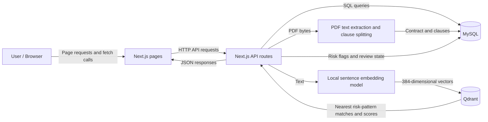

# Review 1 Presentation Guide

This guide is a speaking and preparation guide for the first project review. It describes the system as it is currently implemented, explains how its parts connect, and calls out the limits that should be stated honestly during the review.

## 1. Project in one sentence

**Contract Risk & Clause Intelligence Platform** is a web application that stores contracts and their clauses, compares clause meaning with a small library of known risk patterns, and gives users a role-controlled place to review potential risks and track obligations.

## 2. Short opening explanation

You can introduce the project like this:

> "Our project is a contract-management and risk-review system. A user can upload a text-based PDF contract. The application extracts its text, separates it into clause-like sections, stores the contract and clauses in MySQL, and creates numerical embeddings for semantic search. It compares each clause embedding with risk-pattern embeddings stored in Qdrant. Matches above a configured similarity threshold are saved as risk flags in MySQL. An authorized user can then inspect and mark those flags as reviewed. The goal is to support human review, not to make a legal decision automatically."

## 3. Problem, motivation, and objective

### Problem

Contracts can be long, and similar legal ideas may be written using different words. Manually finding every potentially important clause and keeping review status, obligations, and dates organized can take time.

### Objective

The project demonstrates a connected workflow that:

1. Stores contract and user data in a relational database.
2. Extracts clauses from uploaded PDF files.
3. Uses semantic similarity to find clauses that resemble stored risk patterns.
4. Saves potential findings as reviewable risk flags.
5. Restricts important actions by user role.
6. Provides screens for contracts, risk review, and obligations.

### Proposed solution

The system combines a conventional web application and relational database with a vector database:

- **MySQL** stores authoritative, structured records and their relationships.
- **Qdrant** stores numerical vectors and performs similarity retrieval.
- **Next.js** serves the user interface and server-side API.
- **A local embedding model** converts text into vectors; it does not generate legal advice or a written AI opinion.

### Scope for the current version

The current scope is a local academic prototype: user authentication, contract upload and metadata, text extraction, clause storage, semantic matching against a small sample pattern library, risk review, and basic obligation/deadline records. It is not intended to replace lawyers, support every PDF layout, or provide a production deployment.

## 4. Review 1 presentation order

Use this sequence for a short first-review presentation; adjust it to the teacher's time limit or department rubric:

1. **Title and team:** project name, course, team members, and each member's contribution.
2. **Problem statement:** explain why manual contract review and follow-up tracking are difficult.
3. **Objective and scope:** explain what this prototype will do and what it will not do.
4. **Existing approach and proposed approach:** contrast manual/keyword-only review with the system's structured storage and semantic retrieval. Avoid claiming that the prototype replaces expert review.
5. **Users and requirements:** describe Admin, Reviewer, and Viewer, then summarize functional and quality requirements.
6. **Architecture:** show how the browser, Next.js API, MySQL, embedding model, and Qdrant communicate.
7. **Database design:** present the ER diagram or table relationships, keys, constraints, indexes, and transaction use.
8. **Methodology/workflow:** walk through PDF upload -> extraction -> clauses -> embeddings -> Qdrant search -> MySQL risk flags -> human review.
9. **Current implementation/demo:** show the parts that work, supported by the actual application or source files.
10. **Limitations and next steps:** state OCR, clause parsing, pattern coverage, threshold evaluation, reminders, and planned DB features honestly.

For Review 1, emphasize the problem, objectives, scope, requirements, architecture, database design, and implementation plan/status. Demonstrate only what is already implemented, and label planned work as planned.

## 5. Main modules and requirements

### Modules

- **Authentication and roles:** signup, login, signed session, and server-side access checks.
- **Contract management:** list/view contracts, upload PDF, extract text, create clauses, and start analysis.
- **Semantic risk analysis:** embed clauses and patterns, query Qdrant, apply the threshold, and save candidate matches.
- **Risk review:** list/filter findings and persist review decisions.
- **Obligations and deadlines:** read and create records attached to contracts.
- **Data services:** MySQL for relational records and Qdrant for vector retrieval.

### Functional requirements demonstrated by the implementation

- A user can sign up as a Viewer and log in with valid credentials.
- An authenticated user can view contracts and risk flags.
- An Admin can upload a supported PDF, creating a contract and extracted clause rows.
- The analysis path finds matching risk patterns and stores eligible flags.
- An Admin or Reviewer can mark a flag reviewed; a Viewer cannot.
- Signed-in users can read obligations/deadlines; an Admin can create them.

### Quality requirements and design considerations

- **Data integrity:** primary/foreign keys and constraints maintain valid relations.
- **Access control:** privileged operations enforce roles on the server.
- **Maintainability:** UI, API, database helper, PDF handling, and vector analysis are separated into modules.
- **Availability and performance:** the local app depends on MySQL and Qdrant being available. No production uptime or scale guarantees have been tested.
- **Accuracy:** semantic results depend on extracted text, pattern coverage, model behavior, and the threshold; a person must review results.

## 6. Technology used and why

| Technology | How this project uses it |
|---|---|
| Next.js 16 App Router | Serves the pages and server-side API endpoints in the same application. |
| React 19 | Builds the interactive pages, forms, tables, and review interface. |
| JavaScript / Node.js | Implements application, API, upload, and analysis logic. |
| Tailwind CSS 4 | Styles the interface. |
| MySQL 8.4 | Stores users, roles, contracts, parties, clauses, patterns, risk flags, obligations, and deadlines. |
| `mysql2` | Connects the Node.js application to MySQL using a connection pool for application routes and connections for the analysis scripts. |
| Qdrant | Stores and searches vector embeddings by similarity. |
| `@huggingface/transformers` | Runs `Xenova/all-MiniLM-L6-v2` to generate text embeddings locally. |
| `pdf-parse` | Extracts text from uploaded PDFs. |
| `bcryptjs` | Hashes passwords during signup and checks hashes at login. |
| Docker Compose | Starts local MySQL and Qdrant services with persistent volumes. |
| ESLint | Checks JavaScript code style and common issues. |

The application uses a sentence-embedding model, not a generative chatbot/LLM. The embedding model represents text numerically so that Qdrant can find meaningfully similar stored patterns.

## 7. Architecture: how the pieces connect

### Request path in plain language

1. The user interacts with a page in the browser.
2. That page calls a Next.js API route using `fetch`.
3. The route checks the session and role for protected operations.
4. The route reads or writes structured records in MySQL and, for analysis, calls the embedding/Qdrant code.
5. The route returns JSON to the page, which updates what the user sees.

The browser does not connect directly to MySQL or Qdrant. Server-side code mediates those connections.

## 8. Main user workflow

### A. Sign up or log in

- Signup validates the name, email, and password and stores a `bcryptjs` password hash in `users`.
- Public signup assigns the **Viewer** role; users cannot choose Admin during public signup.
- Login finds the account by email and compares the submitted password with the stored hash.
- On successful authentication, the server sets an HTTP-only session cookie. The cookie contains a signed user identifier and expiry time; the session API looks the user and role up in MySQL.
- Protected API routes reject unauthenticated requests. Role checks are enforced on the server, not just by hiding a button in the UI.

### B. Upload and analyze a contract

The main upload path is `POST /api/contracts` with multipart form data:

1. The route requires a signed-in Admin and checks the upload.
2. It accepts a PDF up to 20 MB and verifies that the file looks like a PDF.
3. `pdf-parse` extracts text. Image-only/scanned PDFs are not supported because OCR is not implemented.
4. A simple heading/blank-line heuristic groups extracted text into clause-like chunks. This is not a legal-grade clause parser.
5. The PDF is stored under `uploads/`, using a SHA-256-derived filename. The contract row and clause rows are inserted into MySQL in a transaction.
6. Each clause is embedded and its vector is stored in Qdrant. Its Qdrant ID is also recorded in the clause row.
7. Risk-pattern text is embedded and stored in Qdrant.
8. Each clause is compared against the nearest risk-pattern vectors. Matches meeting the threshold are written to `risk_flags`.
9. The contract status is updated to `analyzed`; the upload response includes a summary such as clauses created and new flags.

The upload flow also checks for an already stored upload by the same user and file digest. In that case it reuses the saved contract and clauses, then refreshes indexing/analysis instead of making another contract row.

### C. Review potential risks

- The Risk Review page requests flags from `GET /api/risk-flags`, optionally filtered by contract.
- The result joins risk flags to clauses, contracts, risk patterns, categories, and reviewer details in MySQL.
- The interface supports inspecting and filtering the returned findings.
- Admins and Reviewers can mark a flag reviewed. The API records `reviewed = TRUE` and the reviewing user's ID. Viewers can inspect but cannot perform that update.

### D. Manage obligations and deadlines

The obligations and deadlines API routes read and create records associated with contracts. The current routes allow signed-in users to read them and Admins to create them. The database has a `notified` field for deadlines, but an automatic reminder/notification service is not implemented.

## 9. How semantic risk matching works

### What is an embedding?

An embedding is a list of numbers representing text. Text with related meaning may have vectors that are near each other even when the exact wording differs. Here, `Xenova/all-MiniLM-L6-v2` produces 384-dimensional vectors. The code uses mean pooling and normalization.

### Indexing and comparison

- Risk-pattern vectors are saved in Qdrant with payload metadata identifying them as `type: pattern` and linking them to a MySQL pattern ID.
- Contract-clause vectors use `type: clause` and link to a MySQL clause ID.
- During analysis, the clause text is embedded and Qdrant is asked for up to four nearest vectors filtered to `type: pattern`.
- Qdrant uses cosine distance/similarity for the configured collection.
- `analyze_risk.js` applies a similarity threshold of **0.35**. If a match meets it, the script looks up the pattern category in MySQL and inserts a risk flag unless that clause/pattern pair is already flagged.
- The score is a retrieval signal, not a probability that the clause is legally risky. The threshold is a project setting and should be evaluated with representative documents.

**Important distinction:** Clause vectors are indexed, but the current risk-analysis query specifically searches the risk-pattern vectors. The analysis is pattern matching through semantic retrieval; it does not ask a generative model to interpret the contract.

## 10. Database design and relationships

The MySQL schema currently defines 11 tables:

| Table | What it represents |
|---|---|
| `roles` | Role names such as Admin, Reviewer, and Viewer. |
| `users` | User identity, email, password hash, and role reference. |
| `contracts` | Contract metadata, uploader, file path, dates, and status. |
| `parties` | People or organizations named as contract parties. |
| `contract_parties` | Junction table connecting contracts and parties; supports the many-to-many relationship. |
| `risk_categories` | Risk groupings such as Liability, Indemnity, Termination, and Automatic Renewal. |
| `clauses` | Extracted clause text and order, linked to a contract. |
| `risk_patterns` | Example/reference text for each risk pattern and its category. |
| `risk_flags` | A detected clause-to-pattern match, score, category, review status, reviewer, and timestamp. |
| `obligations` | Contract-related obligation description, due date, and status. |
| `deadlines` | Contract-related deadline type, date, and notification flag. |

### Key relationships to explain

- One **role** can be assigned to many **users**.
- One **user** can upload many **contracts**.
- One **contract** can have many **clauses**, **obligations**, and **deadlines**.
- **Contracts** and **parties** have a many-to-many relationship through `contract_parties`.
- A **risk category** can have many **risk patterns**.
- A **clause** can produce risk flags; each **risk flag** refers to a clause and a matching risk pattern, and can record its category and reviewer.

Primary keys identify rows. Foreign keys maintain referential integrity. The `contract_parties` composite primary key prevents duplicate links for the same contract/party pair. Cascading deletes are configured for selected dependent rows such as contract clauses, obligations, deadlines, and party links.

### Relational database versus vector database

MySQL and Qdrant are complementary, not competing databases:

- MySQL is the source of truth for records, relationships, statuses, roles, and review history.
- Qdrant is optimized for finding nearby vectors; its payload includes IDs that let the application connect a result back to its MySQL record.
- The `vector_id` columns in MySQL record the corresponding Qdrant IDs.

## 11. Database concepts demonstrated

For the DBMS part of the review, point to concrete examples:

- **Schema design:** entities are separated into tables instead of placing all contract and review data in one table.
- **Primary and foreign keys:** IDs and references link records and protect relationships.
- **Normalization:** roles, categories, parties, and contracts are represented separately; the junction table models the many-to-many party relationship.
- **Constraints:** unique role names and emails, required columns, enum status values, and foreign keys.
- **Indexes:** `idx_clauses_contract`, `idx_riskflags_clause`, and `idx_deadlines_date` support common relationship/date lookups.
- **Transactions:** contract metadata and the extracted clause rows are inserted together; the upload route commits the transaction on success and rolls it back if those inserts fail.
- **Parameterized SQL:** route/script queries pass values separately from SQL text for the relevant database operations.

### Be precise about database features

The file `database/schema/03_views_triggers_procs.sql` currently contains only a placeholder comment. Therefore, do **not** claim that a view, trigger, or stored procedure is currently implemented. The architecture document mentions examples of these features, but they are not present in the SQL script at this time. The indexes and upload transaction are implemented.

## 12. Roles and permissions

| Action | Admin | Reviewer | Viewer |
|---|:---:|:---:|:---:|
| View contracts and risk information (signed in) | Yes | Yes | Yes |
| Upload/create a contract | Yes | No | No |
| Run contract analysis through the analysis endpoint | Yes | No | No |
| Mark a risk flag reviewed | Yes | Yes | No |
| Create obligations or deadlines | Yes | No | No |
| Public signup | Signup creates a Viewer account | Signup does not grant this role | Signup creates this role |

The upload API automatically runs indexing and risk analysis after saving a PDF. There is also a separate Admin-only analysis endpoint. The application stores password hashes rather than plaintext passwords.

## 13. What is implemented and what is limited

Being clear about scope during Review 1 makes the explanation credible.

### Implemented in the current project

- Next.js web pages and API routes for authentication, contracts, risk flags, obligations, and deadlines.
- MySQL schema and sample seed data.
- PDF text extraction and heuristic clause splitting for text-based PDFs.
- Local sentence embeddings and Qdrant storage/search.
- Risk-flag persistence and review status with role checks.
- Docker Compose configuration for local MySQL and Qdrant.

### Current limitations / not implemented

- Scanned/image-only PDFs need OCR, which is not included.
- Clause boundaries are inferred from headings and blank lines; unusual formatting may split clauses incorrectly.
- The seeded risk-pattern set is small and only covers Liability, Indemnity, Termination, and Automatic Renewal.
- A similarity threshold can yield false positives and false negatives; a human must review every result.
- No generative AI legal explanation, legal conclusion, or automated legal advice is produced.
- Automatic deadline notifications are not implemented.
- The SQL file for views/triggers/stored procedures is still a placeholder; do not present those as completed DBMS features.
- The risk-review endpoint updates a flag's review status; it does not automatically change the parent contract's status to `reviewed`.
- The project is a local academic prototype, not a production-ready legal or security product.

## 14. Suggested live demonstration

Before the review, make sure Docker services are running, the schema and sample data are imported, `.env.local` is configured, and the Next.js app starts. Use the local demo accounts described in the README; keep passwords and environment secrets private.

Suggested sequence:

1. Sign in with an Admin demo account and show the dashboard.
2. Open **Contracts** and show the existing sample contract, or upload a small text-based PDF under 20 MB.
3. Explain that upload extracts text, stores clauses, embeds them, and checks them against risk patterns.
4. Open **Risk Review** for the analyzed contract and show a flag, its clause text, category, similarity score, and review status (if any are found).
5. Mark one flag reviewed with an Admin or Reviewer account and show that the status persists.
6. Briefly show the obligations page or database rows to demonstrate that records are contract-linked.
7. If asked, show the MySQL tables/foreign keys and Qdrant collection as the two complementary storage layers.

Do not depend on getting a risk flag from every arbitrary PDF: a document may have no extractable text or no match above the configured threshold. For a predictable demo, use the supplied sample data or a prepared text-based sample contract.

## 15. Common Review 1 questions and answer cues

**Why use both MySQL and Qdrant?**  
MySQL handles structured records and relationships. Qdrant handles nearest-neighbor search over vectors. A vector match returns IDs/payload that connect it back to the relational records.

**Why not use only keyword search?**  
Keyword matching can miss a similar idea expressed with different words. Embeddings allow similarity search based on text representation, although they are not perfect and still need human review.

**Does the model decide whether a clause is legally dangerous?**  
No. It retrieves similar stored risk patterns and the application records candidate matches above a threshold. A qualified human must assess the context and legal significance.

**What does the similarity score mean?**  
It is a vector similarity score returned by Qdrant, used to rank matches and compare them with the configured cutoff. It is not a calibrated risk probability.

**What happens if the same contract is uploaded again?**  
The upload route hashes the uploader ID and PDF bytes to identify the same upload for that user. It reuses the existing contract and clauses and refreshes the indexing/analysis path.

**How do you protect passwords and restrict access?**  
Passwords are stored as bcrypt hashes. The server issues a signed HTTP-only session cookie. API routes check the authenticated user's role before privileged operations.

**What is the role of foreign keys?**  
They ensure that related records refer to existing users, contracts, clauses, categories, patterns, and parties, maintaining referential integrity.

**What are the current DBMS advanced features?**  
The schema has primary/foreign keys, unique and enum constraints, indexes, a many-to-many junction table, and the upload workflow uses a transaction. The current views/triggers/procedures SQL file is a placeholder, so those features are not implemented yet.

**What would you improve next?**  
Add OCR for scanned PDFs, improve clause segmentation, expand and evaluate the risk-pattern dataset, test/calibrate similarity thresholds, implement deadline reminders, add automated tests, and implement or remove the planned views/triggers/procedures claims in the documentation.

## 16. A concise closing statement

> "The key contribution is the complete data flow from document upload to a reviewable database record: PDF text becomes clause rows, clauses become embeddings, Qdrant retrieves similar risk patterns, and MySQL stores the resulting flags and review decisions. The system is an assistive prototype, so its output is a starting point for human review rather than a legal conclusion."

## 17. Project files to point to during the review

- [Project overview and setup](../README.md)
- [Architecture notes](./architecture.md)
- [Database table definitions](../database/schema/01_create_tables.sql)
- [Database indexes](../database/schema/02_constraints_indexes.sql)
- [Placeholder for planned views/triggers/procedures](../database/schema/03_views_triggers_procs.sql)
- [Sample database records](../database/seed/sample_data.sql)
- [MySQL connection helper](../app/lib/db.js)
- [Session and role helpers](../app/lib/auth.js)
- [PDF extraction and clause splitting](../app/lib/contract-upload.js)
- [Contract upload API](../app/api/contracts/route.js)
- [Risk-analysis logic](../vector-db/analyze_risk.js)
- [Embedding model wrapper](../vector-db/embedding.js)
- [Qdrant connection and search](../vector-db/qdrant.js)
- [Risk flag review API](../app/api/risk-flags/[id]/route.js)
- [Local database services](../docker-compose.yml)
